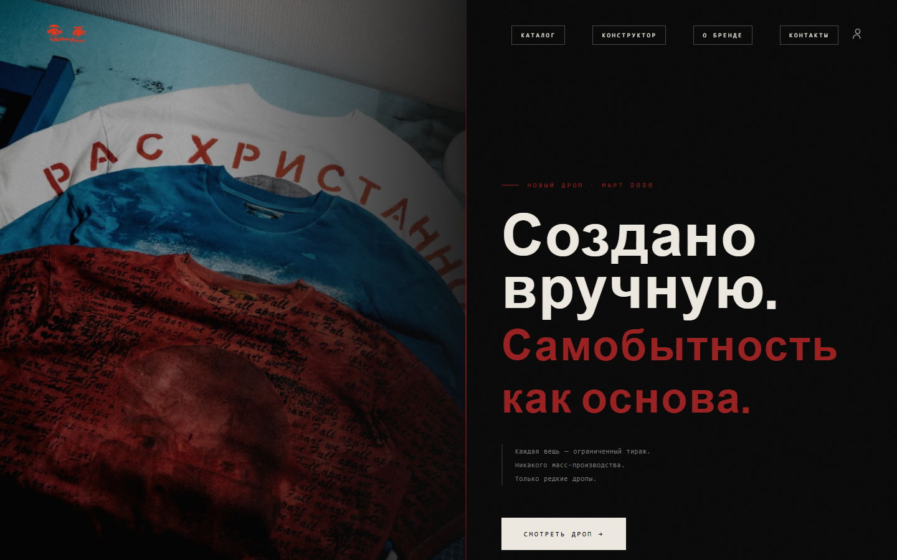
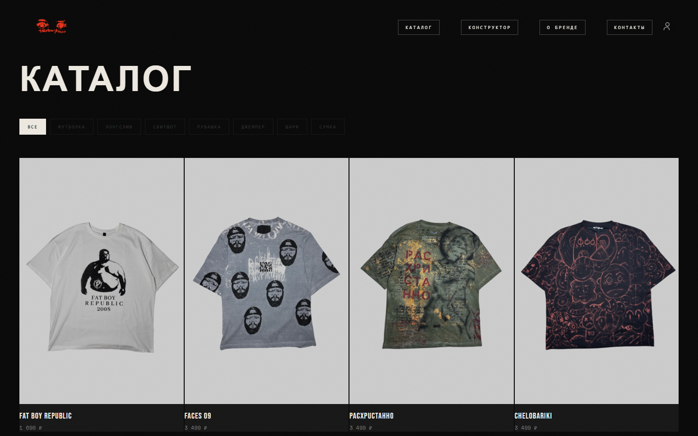
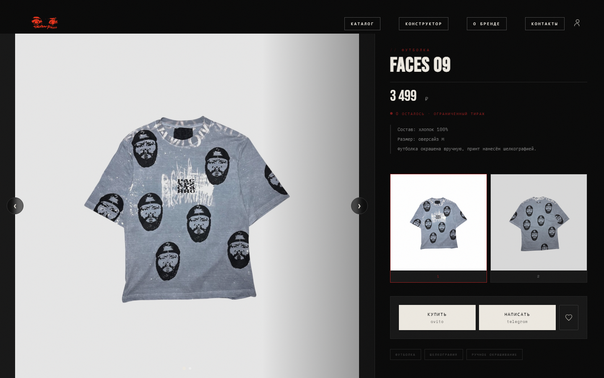
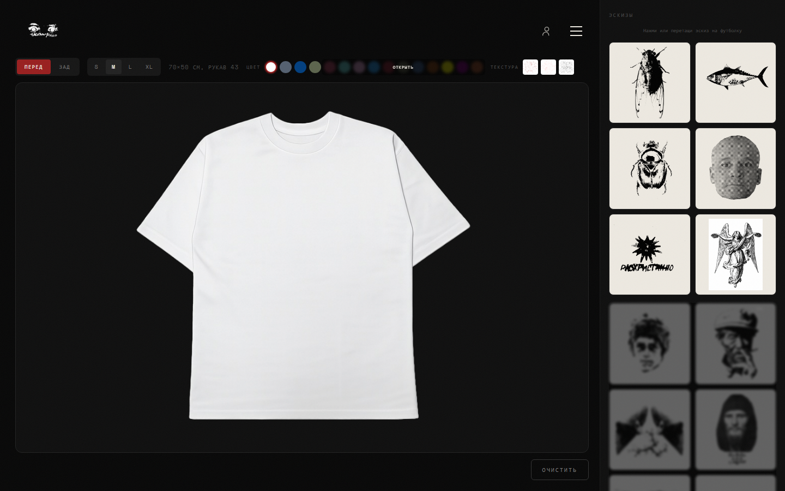
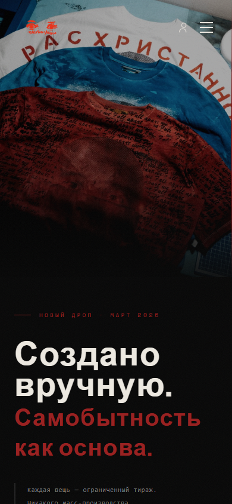

## Problem

My clothing brand, РАСХРИСТАННО, needed a site that carries its visual identity as it is. Products come out as limited drops, so I had to be able to add and rotate products — and change how the home page looks — quickly and on my own, from an admin panel rather than in code.

Sales happen through Telegram and Avito, so the site deliberately has no cart or checkout.

## Solution

The home page combines a cross-fading hero carousel, a marquee, the current drop, bestsellers and the brand's philosophy.

The catalog can be filtered by category. From a product page, visitors buy on Avito or ask a question on Telegram.

The T-shirt designer (`/create`) lets visitors drag and drop sketches, pick colour, texture and size, and export the result as a PNG. Designs can be saved to a personal account — sign-in is a one-time code by email — along with favourites.

On phones the layout switches to a dedicated mobile version, and the designer gets a bottom tab bar.

Behind the scenes, a server-rendered admin panel built with templ manages products, drops, site settings, users, analytics, designer assets and customers, with live logs right in the browser.

## Architecture

<figure class="diagram">
<svg viewBox="0 0 360 348" role="img" aria-labelledby="pacx-arch-title-en">
  <title id="pacx-arch-title-en">System overview: browser → Traefik → Go binary → PostgreSQL, Redis, image storage</title>
  <defs>
    <marker id="pacx-arch-arrow-en" viewBox="0 0 10 10" refX="9" refY="5" markerWidth="7" markerHeight="7" orient="auto-start-reverse">
      <path class="d-arrow" d="M0 0 L10 5 L0 10 z"/>
    </marker>
  </defs>
  <rect class="d-box" x="40" y="8" width="280" height="52" rx="8"/>
  <text class="d-text" x="180" y="30" text-anchor="middle">Browser</text>
  <text class="d-mono" x="180" y="48" text-anchor="middle">React SPA · T-shirt designer</text>
  <path class="d-line" d="M180 60 V84" marker-end="url(#pacx-arch-arrow-en)"/>
  <rect class="d-box" x="40" y="88" width="280" height="52" rx="8"/>
  <text class="d-text" x="180" y="110" text-anchor="middle">Traefik</text>
  <text class="d-mono" x="180" y="128" text-anchor="middle">TLS · Let's Encrypt</text>
  <path class="d-line" d="M180 140 V164" marker-end="url(#pacx-arch-arrow-en)"/>
  <rect class="d-accent" x="10" y="168" width="340" height="76" rx="8"/>
  <text class="d-text" x="180" y="192" text-anchor="middle">Go binary (Gin)</text>
  <text class="d-mono" x="180" y="212" text-anchor="middle">SPA (go:embed) + OG injection</text>
  <text class="d-mono" x="180" y="230" text-anchor="middle">REST API · templ admin</text>
  <path class="d-line" d="M60 244 V276" marker-end="url(#pacx-arch-arrow-en)"/>
  <path class="d-line" d="M180 244 V276" marker-end="url(#pacx-arch-arrow-en)"/>
  <path class="d-line" d="M300 244 V276" marker-end="url(#pacx-arch-arrow-en)"/>
  <rect class="d-box" x="5" y="280" width="110" height="60" rx="8"/>
  <text class="d-text" x="60" y="304" text-anchor="middle">PostgreSQL</text>
  <text class="d-mono" x="60" y="324" text-anchor="middle">sqlc · goose</text>
  <rect class="d-box" x="125" y="280" width="110" height="60" rx="8"/>
  <text class="d-text" x="180" y="304" text-anchor="middle">Redis</text>
  <text class="d-mono" x="180" y="324" text-anchor="middle">sessions</text>
  <rect class="d-box" x="245" y="280" width="110" height="60" rx="8"/>
  <text class="d-text" x="300" y="304" text-anchor="middle">Images</text>
  <text class="d-mono" x="300" y="324" text-anchor="middle">optimised</text>
</svg>
<figcaption>System overview</figcaption>
</figure>

The storefront (React 18 + Vite), the admin panel (templ + Tailwind CSS) and the backend (Go 1.25 + Gin) live in one monorepo. A multi-stage Docker build compiles the frontend and the admin CSS and embeds both into the Go binary with `go:embed`, so production runs exactly one binary.

Data lives in PostgreSQL 16 (pgxpool + sqlc) and sessions in Redis 7 (24 hours for admins, 30 days for users). Migrations are written for goose, embedded in the binary and applied on startup. Uploaded images are optimised on the server (JPEG with a 1200px long side, plus a 1200×630 version for OG), and a push to `main` triggers a GitHub Actions deploy.

## Technical highlights

### Link previews that work for an SPA

An SPA serves the same HTML for every page, so a shared link would show an empty preview in messengers. Before serving `index.html`, the Go server injects the OG title, description and image configured in the admin panel (cached for 60 seconds). On product pages, React also emits per-product OG tags and Schema.org JSON-LD.

### Type-safe SQL without an ORM

All ~85 queries are plain SQL, and sqlc generates the Go code for them. Nothing is hidden behind an ORM, and type mismatches surface at build time. Code generation is part of the Docker build.

### The T-shirt designer

Sketches can be dragged freely around a canvas, colours and textures switched, and the finished design exported as a PNG. On phones the controls collapse into a bottom tab bar so the canvas keeps as much of the small screen as possible.

### Security and privacy

Site settings and third-party secrets are stored encrypted with AES-256-GCM. The built-in analytics records IP addresses only as SHA-256 hashes, and passwords are hashed with bcrypt.

### Easy to operate

Every request gets an X-Request-ID, and zap writes structured logs. The latest 5,000 log entries are kept in a ring buffer and shown in the admin panel, so problems can be traced without logging in to the server.

## Retrospective

Packing everything into one binary made deployment and the server setup very simple. The price is that even a small frontend-only fix requires rebuilding the server.

The UI also ended up split into two stacks — React with plain CSS for the storefront, templ with Tailwind for the admin — so components cannot be shared. That is the next thing I would address.

Development followed specs and implementation plans written with Claude Code. The designer's mobile tab bar, for example, has its spec and plan in the repository and was built in small, separate commits.
